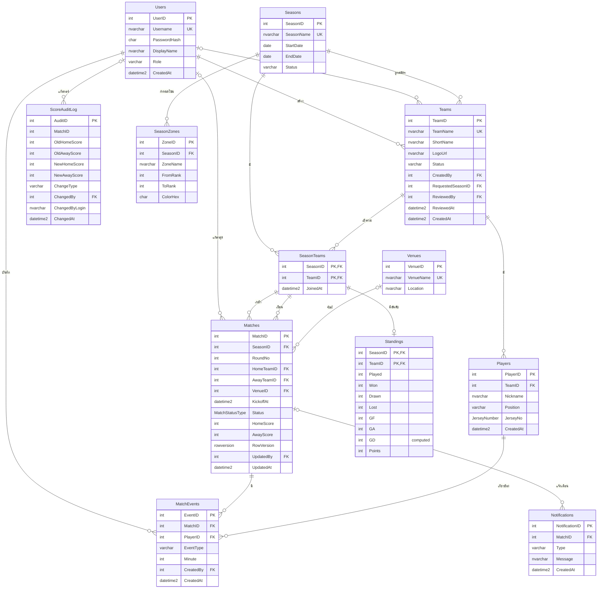

# LeagueBoard — สเปกการออกแบบฐานข้อมูล

เอกสารนี้สำหรับคนสร้างฐานข้อมูล บอกว่าต้องมี **อะไร** และต้องทำงาน **อย่างไร** ส่วนโค้ด SQL ของ trigger, stored procedure และ function เป็นงานของผู้รับผิดชอบฐานข้อมูล จึงไม่มีในเอกสารนี้

| เอกสาร | ใช้ตอบคำถาม |
|---|---|
| `db_design.md` (ไฟล์นี้) | มีตารางอะไร มีกฎอะไร trigger ทำอะไร ทดสอบอย่างไร |
| `db_contract.md` | เว็บเรียก view/function/SP อะไร ส่งอะไร รับอะไร error แบบไหน |
| `db_objects_usage.md` | object แต่ละตัวถูกใช้จริงที่หน้าไหน ใช้อ้างอิงตอนทำเล่มรายงาน |

ถ้าเอกสารขัดกัน ให้ถือ `db_contract.md` เป็นหลักสำหรับสิ่งที่เว็บเรียก และ `db_design.md` เป็นหลักสำหรับโครงสร้างภายใน แล้วแจ้งคนทำเว็บให้แก้เอกสารด้วย

## 1. ข้อกำหนดทั่วไป

- **ฐานข้อมูล:** ชื่อ `LeagueBoard` บน SQL Server 2019 ใช้ collation `Thai_100_CI_AS`
- **ภาษาไทย:** คอลัมน์ที่เก็บข้อความภาษาไทยต้องเป็น `NVARCHAR` และค่าคงที่ภาษาไทยในสคริปต์ต้องมี `N` นำหน้า เช่น `N'วิศวกรรม'` ไม่เช่นนั้นจะกลายเป็น `?`
- **Schema:** ทุก object อยู่ใน `dbo`
- **ชื่อ:** ใช้ชื่อตาราง คอลัมน์ และ constraint ตามเอกสารนี้ทุกตัวอักษร เพราะ `mock-data/` ใช้ชื่อเดียวกัน เว็บแปลง error จากชื่อ constraint และ `npm run db:check` ตรวจจากชื่อเหล่านี้
- **เวลา:** ใช้ `DATETIME2(0)` เก็บเวลาท้องถิ่น (Asia/Bangkok) และใช้ `SYSDATETIME()` เป็นค่าเวลาปัจจุบัน
- **การลบ:** Foreign key ทุกตัวเป็น `ON DELETE NO ACTION` ยกเว้นที่ระบุไว้

### ลำดับไฟล์ SQL

ไฟล์ทั้งหมดอยู่ใน `database/` รันตามลำดับนี้

| ลำดับ | ไฟล์ | เนื้อหา |
|---|---|---|
| 0 | `00_create_database.sql` | สร้างฐานข้อมูลและกำหนด collation |
| 1 | `01_types_rules_defaults.sql` | User-Defined Type, Rule, Default |
| 2 | `02_tables.sql` | ตาราง, constraint, index |
| 3 | `03_functions.sql` | Function |
| 4 | `04_views.sql` | View |
| 5 | `05_procedures.sql` | Stored Procedure |
| 6 | `06_triggers.sql` | Trigger |
| 7 | `07_security.sql` | Role, login, user, สิทธิ์ |
| 8 | `08_sample_data.sql` | ข้อมูลตัวอย่าง |

ไฟล์ type ต้องมาก่อนตาราง เพราะ `Players` และ `Matches` ใช้ type เหล่านี้ใน `CREATE TABLE`

ลำดับการสร้างตารางใน `02_tables.sql` ตามการอ้างอิง FK: `Users` → `Seasons` → `Teams` → `SeasonTeams` → `Players` → `Venues` → `Matches` → `MatchEvents` → `Standings` → `ScoreAuditLog` → `SeasonZones` → `Notifications`

## 2. Type, Rule และ Default

| ชื่อ | ประเภท | ฐาน | กฎ |
|---|---|---|---|
| `JerseyNumber` | User-Defined Type | `TINYINT` | ใช้กับ `Players.JerseyNo` |
| `rule_JerseyNumber` | Rule ผูกกับ `JerseyNumber` | | ค่าต้องอยู่ระหว่าง 1–99 |
| `MatchStatusType` | User-Defined Type | `VARCHAR(20)` | ใช้กับ `Matches.Status` |
| `dft_MatchStatus` | Default ผูกกับ `MatchStatusType` | | ค่าเริ่มต้น `'Scheduled'` |

Rule และ Default ต้องผูกกับ type ก่อนสร้างตาราง ค่าที่ผิด Rule จะเกิด error 513 ซึ่งเว็บรองรับแล้ว

## 3. ตาราง

ในตารางด้านล่าง "NN" คือ `NOT NULL` ชื่อ constraint ที่ระบุไว้ต้องตั้งตามนี้

### Users

บัญชีผู้ใช้เว็บ ไม่เกี่ยวกับ SQL login

| คอลัมน์ | ชนิด | NN | หมายเหตุ |
|---|---|---|---|
| `UserID` | `INT IDENTITY(1,1)` | ✓ | PK `PK_Users` |
| `Username` | `NVARCHAR(50)` | ✓ | UNIQUE `UQ_Users_Username` |
| `PasswordHash` | `CHAR(60)` | ✓ | bcrypt hash เว็บเป็นคนสร้าง ฐานข้อมูลไม่ตรวจรหัสผ่านเอง |
| `DisplayName` | `NVARCHAR(100)` | ✓ | |
| `Role` | `VARCHAR(20)` | ✓ | DEFAULT `'team_manager'`, CHECK `CK_Users_Role`: `admin`, `referee`, `team_manager` |
| `CreatedAt` | `DATETIME2(0)` | ✓ | DEFAULT `SYSDATETIME()` |

### Seasons

| คอลัมน์ | ชนิด | NN | หมายเหตุ |
|---|---|---|---|
| `SeasonID` | `INT IDENTITY(1,1)` | ✓ | PK `PK_Seasons` |
| `SeasonName` | `NVARCHAR(100)` | ✓ | UNIQUE `UQ_Seasons_SeasonName` |
| `StartDate` | `DATE` | ✓ | |
| `EndDate` | `DATE` | ✓ | CHECK `CK_Seasons_Dates`: `EndDate >= StartDate` |
| `Status` | `VARCHAR(20)` | ✓ | DEFAULT `'Upcoming'`, CHECK `CK_Seasons_Status`: `Upcoming`, `Active`, `Finished` |

- Unique filtered index `UX_Seasons_OneActive` บน `Status` เฉพาะแถว `Status = 'Active'` เพื่อให้มีฤดูกาล Active ได้ทีละหนึ่งเดียว

### Teams

| คอลัมน์ | ชนิด | NN | หมายเหตุ |
|---|---|---|---|
| `TeamID` | `INT IDENTITY(1,1)` | ✓ | PK `PK_Teams` |
| `TeamName` | `NVARCHAR(100)` | ✓ | UNIQUE `UQ_Teams_TeamName` |
| `ShortName` | `NVARCHAR(10)` | ✓ | ชื่อย่อแสดงในตาราง |
| `LogoUrl` | `NVARCHAR(300)` | | NULL ได้ เว็บแสดงโลโก้เริ่มต้นแทน |
| `Status` | `VARCHAR(10)` | ✓ | DEFAULT `'Pending'`, CHECK `CK_Teams_Status`: `Pending`, `Approved`, `Rejected` |
| `CreatedBy` | `INT` | ✓ | FK `FK_Teams_Users` → `Users(UserID)` |
| `RequestedSeasonID` | `INT` | ✓ | FK `FK_Teams_Seasons` → `Seasons(SeasonID)` ฤดูกาลที่สมัครเข้าร่วม |
| `ReviewedBy` | `INT` | | FK `FK_Teams_ReviewedBy` → `Users(UserID)` |
| `ReviewedAt` | `DATETIME2(0)` | | |
| `CreatedAt` | `DATETIME2(0)` | ✓ | DEFAULT `SYSDATETIME()` |

### SeasonTeams

| คอลัมน์ | ชนิด | NN | หมายเหตุ |
|---|---|---|---|
| `SeasonID` | `INT` | ✓ | PK ร่วม `PK_SeasonTeams`, FK `FK_SeasonTeams_Seasons` |
| `TeamID` | `INT` | ✓ | PK ร่วม, FK `FK_SeasonTeams_Teams` |
| `JoinedAt` | `DATETIME2(0)` | ✓ | DEFAULT `SYSDATETIME()` |

### Players

เก็บเท่าที่จำเป็นเท่านั้น คือชื่อเล่น ตำแหน่ง และเบอร์เสื้อ ห้ามเพิ่มข้อมูลส่วนบุคคลอื่น

| คอลัมน์ | ชนิด | NN | หมายเหตุ |
|---|---|---|---|
| `PlayerID` | `INT IDENTITY(1,1)` | ✓ | PK `PK_Players` |
| `TeamID` | `INT` | ✓ | FK `FK_Players_Teams` |
| `Nickname` | `NVARCHAR(50)` | ✓ | |
| `Position` | `VARCHAR(2)` | ✓ | CHECK `CK_Players_Position`: `GK`, `DF`, `MF`, `FW` |
| `JerseyNo` | `JerseyNumber` | ✓ | UNIQUE ร่วมกับ `TeamID` ชื่อ `UQ_Players_Team_Jersey` |
| `CreatedAt` | `DATETIME2(0)` | ✓ | DEFAULT `SYSDATETIME()` |

### Venues

| คอลัมน์ | ชนิด | NN | หมายเหตุ |
|---|---|---|---|
| `VenueID` | `INT IDENTITY(1,1)` | ✓ | PK `PK_Venues` |
| `VenueName` | `NVARCHAR(100)` | ✓ | UNIQUE `UQ_Venues_VenueName` |
| `Location` | `NVARCHAR(200)` | | |

### Matches

| คอลัมน์ | ชนิด | NN | หมายเหตุ |
|---|---|---|---|
| `MatchID` | `INT IDENTITY(1,1)` | ✓ | PK `PK_Matches` |
| `SeasonID` | `INT` | ✓ | |
| `RoundNo` | `INT` | ✓ | CHECK `CK_Matches_Round`: `>= 1` |
| `HomeTeamID` | `INT` | ✓ | FK ร่วม `FK_Matches_HomeTeam`: `(SeasonID, HomeTeamID)` → `SeasonTeams(SeasonID, TeamID)` |
| `AwayTeamID` | `INT` | ✓ | FK ร่วม `FK_Matches_AwayTeam`: `(SeasonID, AwayTeamID)` → `SeasonTeams(SeasonID, TeamID)` |
| `VenueID` | `INT` | | FK `FK_Matches_Venues` |
| `KickoffAt` | `DATETIME2(0)` | ✓ | |
| `Status` | `MatchStatusType` | ✓ | ค่าเริ่มต้นมาจาก `dft_MatchStatus`, CHECK `CK_Matches_Status`: `Scheduled`, `Finished` |
| `HomeScore` | `INT` | | |
| `AwayScore` | `INT` | | |
| `RowVersion` | `ROWVERSION` | ✓ | กันการแก้ทับกัน (ใส่วงเล็บ `[RowVersion]` เพื่อไม่ให้สับสนกับชื่อชนิดข้อมูล) |
| `UpdatedBy` | `INT` | | FK `FK_Matches_UpdatedBy` → `Users(UserID)` ผู้แก้ล่าสุด SP เป็นคนกำหนด |
| `UpdatedAt` | `DATETIME2(0)` | | |

Constraint ระดับตาราง

| ชื่อ | เงื่อนไข |
|---|---|
| `CK_Matches_DifferentTeams` | `HomeTeamID <> AwayTeamID` |
| `CK_Matches_ScoreNonNegative` | ถ้ามีสกอร์ ต้องไม่ติดลบทั้งสองฝั่ง |
| `CK_Matches_FinishedHasScore` | `Status = 'Finished'` ต้องมีสกอร์ครบทั้งคู่ ส่วนสถานะอื่นต้องเป็น NULL ทั้งคู่ |
| `UQ_Matches_Season_Pair` | UNIQUE `(SeasonID, HomeTeamID, AwayTeamID)` คู่เหย้า-เยือนเดียวกันมีได้ครั้งเดียวต่อฤดูกาล |

### MatchEvents

| คอลัมน์ | ชนิด | NN | หมายเหตุ |
|---|---|---|---|
| `EventID` | `INT IDENTITY(1,1)` | ✓ | PK `PK_MatchEvents` |
| `MatchID` | `INT` | ✓ | FK `FK_MatchEvents_Matches` |
| `PlayerID` | `INT` | ✓ | FK `FK_MatchEvents_Players` |
| `EventType` | `VARCHAR(10)` | ✓ | CHECK `CK_MatchEvents_Type`: `Goal`, `Yellow`, `Red` |
| `Minute` | `INT` | ✓ | CHECK `CK_MatchEvents_Minute`: 0–120 |
| `CreatedBy` | `INT` | ✓ | FK `FK_MatchEvents_Users` |
| `CreatedAt` | `DATETIME2(0)` | ✓ | DEFAULT `SYSDATETIME()` |

ฐานข้อมูลไม่บังคับให้จำนวน `Goal` เท่ากับสกอร์ เพราะผู้ตัดสินกรอกสกอร์ก่อนแล้วจึงทยอยกรอกเหตุการณ์ หน้าเว็บจะเตือนถ้าไม่ตรงกัน

### Standings

ข้อมูลในตารางนี้มาจาก trigger เท่านั้น ห้ามแก้ด้วยมือ

| คอลัมน์ | ชนิด | NN | หมายเหตุ |
|---|---|---|---|
| `SeasonID` | `INT` | ✓ | PK ร่วม `PK_Standings` |
| `TeamID` | `INT` | ✓ | PK ร่วม, FK ร่วม `FK_Standings_SeasonTeams`: `(SeasonID, TeamID)` → `SeasonTeams` |
| `Played` | `INT` | ✓ | DEFAULT 0 |
| `Won` | `INT` | ✓ | DEFAULT 0 |
| `Drawn` | `INT` | ✓ | DEFAULT 0 |
| `Lost` | `INT` | ✓ | DEFAULT 0 |
| `GF` | `INT` | ✓ | DEFAULT 0 |
| `GA` | `INT` | ✓ | DEFAULT 0 |
| `GD` | computed | | `GF - GA` |
| `Points` | `INT` | ✓ | DEFAULT 0 |

CHECK `CK_Standings_NonNegative`: ทุกคอลัมน์ตัวเลขข้างต้น ยกเว้น `GD` ต้องไม่ติดลบ

### ScoreAuditLog

ประวัติการแก้สกอร์ ต้องอยู่ได้แม้แมตช์ถูกลบ จึงไม่มี FK ไป `Matches`

| คอลัมน์ | ชนิด | NN | หมายเหตุ |
|---|---|---|---|
| `AuditID` | `INT IDENTITY(1,1)` | ✓ | PK `PK_ScoreAuditLog` |
| `MatchID` | `INT` | ✓ | ไม่มี FK |
| `OldHomeScore` | `INT` | | |
| `OldAwayScore` | `INT` | | |
| `NewHomeScore` | `INT` | | |
| `NewAwayScore` | `INT` | | |
| `ChangeType` | `VARCHAR(10)` | ✓ | CHECK `CK_ScoreAuditLog_ChangeType`: `UPDATE`, `DELETE` |
| `ChangedBy` | `INT` | | FK `FK_ScoreAuditLog_Users` ผู้ใช้เว็บ, NULL เมื่อลบแถวตรงจากฐานข้อมูล |
| `ChangedByLogin` | `NVARCHAR(128)` | ✓ | DEFAULT `SUSER_SNAME()` SQL login ที่ทำรายการ |
| `ChangedAt` | `DATETIME2(0)` | ✓ | DEFAULT `SYSDATETIME()` |

### SeasonZones

โซนสีในตารางคะแนน เช่น อันดับ 1–2 เข้ารอบ อันดับ 8 ตกชั้น

| คอลัมน์ | ชนิด | NN | หมายเหตุ |
|---|---|---|---|
| `ZoneID` | `INT IDENTITY(1,1)` | ✓ | PK `PK_SeasonZones` |
| `SeasonID` | `INT` | ✓ | FK `FK_SeasonZones_Seasons` |
| `ZoneName` | `NVARCHAR(50)` | ✓ | |
| `FromRank` | `INT` | ✓ | UNIQUE ร่วมกับ `SeasonID` ชื่อ `UQ_SeasonZones_Season_From` |
| `ToRank` | `INT` | ✓ | CHECK `CK_SeasonZones_Range`: `FromRank >= 1 AND ToRank >= FromRank` |
| `ColorHex` | `CHAR(7)` | ✓ | CHECK `CK_SeasonZones_Color`: รูปแบบ `#RRGGBB` |

### Notifications

| คอลัมน์ | ชนิด | NN | หมายเหตุ |
|---|---|---|---|
| `NotificationID` | `INT IDENTITY(1,1)` | ✓ | PK `PK_Notifications` |
| `MatchID` | `INT` | | FK `FK_Notifications_Matches` แบบ `ON DELETE SET NULL` |
| `Type` | `VARCHAR(20)` | ✓ | CHECK `CK_Notifications_Type`: `MatchFinished`, `ResultCorrected` |
| `Message` | `NVARCHAR(300)` | ✓ | |
| `CreatedAt` | `DATETIME2(0)` | ✓ | DEFAULT `SYSDATETIME()` |

### Index เพิ่มเติม

| ตาราง | คอลัมน์ | ใช้กับ |
|---|---|---|
| `Matches` | `SeasonID, Status, KickoffAt` | หน้าโปรแกรม, trigger คำนวณคะแนน, `fn_TeamForm` |
| `Matches` | `HomeTeamID` | หน้าทีม, `fn_HeadToHead` |
| `Matches` | `AwayTeamID` | หน้าทีม, `fn_HeadToHead` |
| `MatchEvents` | `MatchID` | รายละเอียดแมตช์ |
| `MatchEvents` | `PlayerID, EventType` | `vw_TopScorers` |

## 4. ER Diagram

## 5. Function

รายละเอียดพารามิเตอร์และผลลัพธ์อยู่ใน `db_contract.md` ส่วนนี้เป็นกฎการคำนวณ

| ชื่อ | ชนิด | กฎ |
|---|---|---|
| `fn_CalcPoints(@gf, @ga)` | Scalar | ชนะ 3, เสมอ 1, แพ้ 0 ต้องถูกเรียกใน `trg_Matches_UpdateStandings` ห้ามเขียนเลข 3/1/0 ซ้ำใน trigger |
| `fn_TeamForm(@SeasonID, @TeamID)` | Scalar | ผล 5 นัดล่าสุดที่ `Finished` ของทีมในฤดูกาล เรียงซ้ายเก่าสุด ขวาล่าสุด ใช้ตัวอักษร `W`, `D`, `L` เช่น `'WWDLW'` ถ้าแข่งไม่ถึง 5 นัดคืนเท่าที่มี ถ้ายังไม่แข่งคืน `''` |
| `fn_HeadToHead(@TeamA, @TeamB)` | Table-valued | ทุกแมตช์ `Finished` ระหว่างสองทีม ทุกฤดูกาล ทั้งสองทิศทางเหย้า-เยือน ผลต้องเหมือนกันเมื่อสลับพารามิเตอร์ |

นัดล่าสุดตัดสินจาก `KickoffAt` ถ้าเวลาเท่ากันใช้ `MatchID` ค่ามากเป็นนัดที่ใหม่กว่า

## 6. Trigger

### trg_Matches_UpdateStandings

- **ตาราง / เหตุการณ์:** `Matches` — AFTER INSERT, UPDATE, DELETE
- **พฤติกรรม:** หาทุกฤดูกาลที่ได้รับผลกระทบจาก `inserted` และ `deleted` แล้วคำนวณ `Standings` ของฤดูกาลนั้นใหม่ทั้งหมดจากแมตช์ที่ `Finished`
- **ทีมที่ยังไม่แข่ง:** ทุกทีมใน `SeasonTeams` ต้องมีแถวใน `Standings` และเป็น 0
- **คะแนน:** ต้องเรียก `fn_CalcPoints`
- **Multi-row:** คำสั่งเดียวที่กระทบหลายแถวหรือหลายฤดูกาลต้องได้ผลถูกต้อง

### trg_Matches_AuditScore

- **ตาราง / เหตุการณ์:** `Matches` — AFTER UPDATE, DELETE
- **พฤติกรรม UPDATE:** เพิ่มแถว `ChangeType = 'UPDATE'` เฉพาะแมตช์ที่ `HomeScore` หรือ `AwayScore` เปลี่ยนจริง โดยเทียบแบบรองรับ NULL ทั้งการกรอกครั้งแรก (NULL → ค่า) และการลบผล (ค่า → NULL) ใช้ `inserted.UpdatedBy` เป็น `ChangedBy`
- **พฤติกรรม DELETE:** บันทึกทุกแถวที่มีสกอร์ `ChangeType = 'DELETE'`, ค่าใหม่เป็น NULL, `ChangedBy` เป็น NULL
- **ไม่บันทึก INSERT:** ข้อมูลตัวอย่างจึงไม่ปนใน audit log
- **เหตุที่ใช้ `UpdatedBy`:** เว็บต่อฐานข้อมูลด้วย login กลางตาม role ค่าจาก `SUSER_SNAME()` จึงบอกได้แค่ role ไม่ใช่ตัวคน

### trg_MatchEvents_ValidatePlayer

- **ตาราง / เหตุการณ์:** `MatchEvents` — AFTER INSERT, UPDATE
- **พฤติกรรม:** ทุกแถวต้องมีนักเตะจากทีมเหย้าหรือทีมเยือนของแมตช์นั้น ถ้ามีแถวใดผิด ให้ยกเลิกทั้งคำสั่งด้วย `THROW 51010`

### trg_Teams_Approved

- **ตาราง / เหตุการณ์:** `Teams` — AFTER UPDATE
- **พฤติกรรม:** เฉพาะทีมที่ `Status` เปลี่ยนเป็น `Approved` จริง (เทียบ `deleted` กับ `inserted`) ให้เพิ่มแถวใน `SeasonTeams` ตาม `RequestedSeasonID` และเพิ่มแถวศูนย์ใน `Standings`
- **ไม่ทำซ้ำ:** ถ้ามีแถวอยู่แล้วต้องข้ามโดยไม่ error

### trg_Teams_LimitPerUser

- **ตาราง / เหตุการณ์:** `Teams` — AFTER INSERT
- **พฤติกรรม:** ผู้ใช้หนึ่งคนมีทีมสถานะ `Pending` หรือ `Approved` รวมกันได้ไม่เกิน 3 ทีม ถ้าเกินให้ยกเลิกด้วย `THROW 51032` ทีม `Rejected` ไม่นับ
- **ผลต่อข้อมูลตัวอย่าง:** ทีมตัวอย่าง 8 ทีมต้องมีผู้สร้างอย่างน้อย 3 คน

### ข้อควรระวังร่วมของ trigger

- ทุก trigger ต้องรองรับ multi-row ห้ามอ่าน `inserted` หรือ `deleted` ใส่ตัวแปรเดี่ยว
- `INSERT` ทีมสถานะ `Approved` ตรงๆ ใน `08_sample_data.sql` จะไม่ทำให้ `trg_Teams_Approved` ทำงาน เพราะ trigger ฟังเฉพาะ UPDATE สคริปต์ตัวอย่างจึงต้องเพิ่ม `SeasonTeams` เอง
- เว็บแสดงข้อความจากเลข error จึงต้องคงเลขเดิมเมื่อ error ถูกส่งต่อ ดู "กฎการ THROW" ใน `db_contract.md`

## 7. Security

เว็บมี 5 SQL login แต่ละ role ได้สิทธิ์ของตัวเองเท่านั้น และ **ไม่มี role ใดได้สิทธิ์ตรงบนตาราง** ทุกอย่างผ่าน view และ SP โดยอาศัย ownership chaining ของ `dbo`

| Database role | SQL login | ใช้เมื่อ |
|---|---|---|
| `role_viewer` | `lb_viewer` | ยังไม่ login |
| `role_team_manager` | `lb_team_manager` | ผู้ใช้ role `team_manager` |
| `role_referee` | `lb_referee` | ผู้ใช้ role `referee` |
| `role_admin` | `lb_admin` | ผู้ใช้ role `admin` |
| `role_checker` | `lb_checker` | `npm run db:check` และหน้า `/db-check` |

| สิทธิ์ | viewer | team_manager | referee | admin | checker |
|---|---|---|---|---|---|
| SELECT view ทุกตัว ยกเว้น `vw_ScoreAudit` | ✓ | ✓ | ✓ | ✓ | |
| SELECT `vw_ScoreAudit` | | | | ✓ | |
| SELECT `fn_HeadToHead` | ✓ | ✓ | ✓ | ✓ | |
| EXECUTE `usp_GetUserForLogin`, `usp_RegisterUser`, `usp_SearchPlayers` | ✓ | ✓ | ✓ | ✓ | |
| EXECUTE `usp_RegisterTeam`, `usp_RegisterPlayer` | | ✓ | | | |
| EXECUTE `usp_RecordMatchResult`, `usp_ClearMatchResult`, `usp_AddMatchEvent`, `usp_DeleteMatchEvent` | | | ✓ | | |
| EXECUTE `usp_CreateSeason`, `usp_SetSeasonStatus`, `usp_GenerateFixtures`, `usp_AddTeamToSeason`, `usp_ApproveTeam` | | | | ✓ | |
| VIEW DEFINITION ระดับฐานข้อมูล | | | | | ✓ |

- ห้ามใช้ `DENY` บนตารางกับ `role_viewer` ถ้าทำให้ role อื่นเป็นสมาชิกของ `role_viewer` เพราะ `DENY` จะมีผลต่อ role นั้นด้วย
- `role_checker` ต้องมี `VIEW DEFINITION` เพราะ login อื่นมองไม่เห็น metadata ของ object ที่ไม่มีสิทธิ์
- รหัสผ่านของ SQL login อยู่ใน `.env` เท่านั้น ห้าม commit ไฟล์ที่มีรหัสผ่านจริง ใน `07_security.sql` ให้ใช้ค่าตัวอย่างที่ชัดเจนว่าต้องเปลี่ยน

## 8. ส่วนเสริม (ทำถ้ามีเวลา)

ส่วนนี้ไม่ทำก็ใช้งานระบบได้ครบ `npm run db:check` จะรายงานเป็นคำเตือน ไม่ใช่ข้อผิดพลาด แต่ถ้าทำต้องใช้จริงและเพิ่มลง `db_objects_usage.md`

| ส่วนเสริม | ค่าพื้นฐานที่ไม่ต้องทำเพิ่ม | ถ้าทำ |
|---|---|---|
| Service Broker | `usp_RecordMatchResult` เขียน `Notifications` เอง | ให้ SP ส่ง message เข้า queue แล้วให้ activation procedure เขียนตารางแทน ผลใน `Notifications` ต้องเหมือนเดิม |
| Full-Text Catalog | `usp_SearchPlayers` ค้นด้วย `LIKE` | เปลี่ยนภายใน SP ให้ใช้ Full-Text โดยชื่อพารามิเตอร์และคอลัมน์ผลลัพธ์ไม่เปลี่ยน ต้องติดตั้งฟีเจอร์ Full-Text ก่อน |
| Synonym | ไม่มี | ใช้ภายใน SP หรือ view อย่างน้อยหนึ่งตัว เว็บยังเรียกชื่อตาม contract |
| Filegroup แยก | ใช้ `PRIMARY` | เช่น แยกตาราง log ไว้ filegroup ของตัวเอง กำหนดใน `00_create_database.sql` |

## 9. กรณีทดสอบที่ฐานข้อมูลต้องผ่าน

ทดสอบใน SSMS ด้วยสิทธิ์ผู้ดูแล เว้นแต่ระบุเป็นอย่างอื่น "ปฏิเสธ" หมายถึงต้องเกิด error ตามที่ระบุและข้อมูลต้องไม่เปลี่ยน

### A. Constraint

| รหัส | การทดสอบ | ผลที่ต้องได้ |
|---|---|---|
| T-01 | เพิ่มนักเตะเบอร์ซ้ำในทีมเดียวกัน | ปฏิเสธ 2627 `UQ_Players_Team_Jersey` |
| T-02 | `INSERT` นักเตะเบอร์ 0 และเบอร์ 100 ตรงเข้าตาราง | ปฏิเสธ 513 จาก Rule |
| T-03 | เพิ่มนักเตะเบอร์เดียวกันคนละทีม | สำเร็จ |
| T-04 | สร้างแมตช์ที่ทีมเหย้าและเยือนเป็นทีมเดียวกัน | ปฏิเสธ 547 `CK_Matches_DifferentTeams` |
| T-05 | ตั้งสกอร์ติดลบ | ปฏิเสธ 547 `CK_Matches_ScoreNonNegative` |
| T-06 | ตั้ง `Status = 'Finished'` โดยไม่มีสกอร์ | ปฏิเสธ 547 `CK_Matches_FinishedHasScore` |
| T-07 | แมตช์ `Scheduled` มีสกอร์ | ปฏิเสธ 547 `CK_Matches_FinishedHasScore` |
| T-08 | สร้างแมตช์โดยไม่ระบุ `Status` | ได้ค่า `Scheduled` |
| T-09 | เพิ่มเหตุการณ์นาทีที่ 121 | ปฏิเสธ 547 `CK_MatchEvents_Minute` |
| T-10 | เพิ่มเหตุการณ์ชนิด `Foul` | ปฏิเสธ 547 `CK_MatchEvents_Type` |
| T-11 | ดู `GD` ของทีมที่ `GF = 7`, `GA = 3` | ได้ 4 และสั่ง UPDATE `GD` ไม่ได้ |
| T-12 | บันทึกและอ่านชื่อทีมภาษาไทย | ตัวอักษรถูกต้อง ไม่เป็น `?` |
| T-13 | ตั้งฤดูกาลที่สองเป็น `Active` ตรงที่ตาราง | ปฏิเสธ 2601 `UX_Seasons_OneActive` |

### B. Trigger

| รหัส | การทดสอบ | ผลที่ต้องได้ |
|---|---|---|
| T-20 | บันทึกผล เหย้า 2–1 เยือน | เหย้า `Won+1`, `Points+3`, `GF+2`, `GA+1`; เยือน `Lost+1`, `Points+0` |
| T-21 | บันทึกผล 1–1 | ทั้งสองทีม `Drawn+1`, `Points+1` |
| T-22 | แก้ผลจาก 2–1 เป็น 0–3 | คะแนนทั้งสองทีมเท่ากับว่าเดิมเป็น 0–3 ตั้งแต่แรก ไม่บวกซ้อน |
| T-23 | ลบผลของแมตช์ | ตารางคะแนนกลับเท่าก่อนกรอก |
| T-24 | `DELETE` แมตช์ที่จบแล้วตรงๆ | ตารางคะแนนถูกคำนวณใหม่ และมี audit `DELETE` |
| T-25 | คำสั่ง UPDATE เดียวแก้สกอร์ 2 แมตช์คนละฤดูกาล | ตารางคะแนนทั้งสองฤดูกาลถูกต้อง |
| T-26 | ฤดูกาลที่บางทีมยังไม่แข่ง | ทีมนั้นยังมีแถวใน `Standings` เป็น 0 |
| T-27 | referee แก้ผลจาก 2–1 เป็น 3–1 | มี audit เก็บ 2,1 → 3,1, `ChangedBy` เป็นผู้แก้, มี `ChangedByLogin` และเวลา |
| T-28 | UPDATE แมตช์โดยสกอร์ไม่เปลี่ยน เช่น แก้สนาม | ไม่มี audit แถวใหม่ |
| T-29 | เพิ่มเหตุการณ์นักเตะทีมอื่น | ปฏิเสธ 51010 |
| T-30 | INSERT เหตุการณ์ 2 แถวในคำสั่งเดียว โดยผิด 1 แถว | ปฏิเสธ 51010 และไม่มีแถวใดถูกเพิ่ม |
| T-31 | อนุมัติทีม | มีแถวใน `SeasonTeams` และ `Standings` เป็น 0 |
| T-32 | UPDATE ทีม Approved โดยไม่เปลี่ยน `Status` | ไม่เกิดแถวซ้ำ ไม่เกิด error |
| T-33 | ผู้ใช้มีทีม 3 ทีมแล้วสมัครทีมที่ 4 | ปฏิเสธ 51032 |
| T-34 | ผู้ใช้มีทีม `Approved` 2 ทีมและ `Rejected` 5 ทีม แล้วสมัครเพิ่ม | สำเร็จ |

### C. View และ Function

| รหัส | การทดสอบ | ผลที่ต้องได้ |
|---|---|---|
| T-40 | สองทีม `Points`, `GD`, `GF` เท่ากันทุกค่า | `RankNo` เท่ากัน และอันดับถัดไปข้ามเลข |
| T-41 | ทีมแข่ง W, W, D, L, W, L ตามลำดับเวลา | `fn_TeamForm` คืน `'WDLWL'` |
| T-42 | ทีมแข่ง 2 นัด และทีมยังไม่แข่ง | คืนสตริงยาว 2 และ `''` |
| T-43 | `fn_CalcPoints(2,1)`, `(1,1)`, `(0,1)` | 3, 1, 0 |
| T-44 | `fn_HeadToHead(A,B)` เทียบ `fn_HeadToHead(B,A)` | ผลเหมือนกัน และมีเฉพาะแมตช์ `Finished` |
| T-45 | `vw_TopScorers` เมื่อมีทั้งใบเหลืองและประตู | นับเฉพาะ `Goal` |
| T-46 | `vw_LeagueTable` ของฤดูกาลที่มีโซน | ทีมในช่วงอันดับได้ `ZoneName`, `ColorHex` ถูกต้อง นอกช่วงเป็น NULL |
| T-47 | `vw_UpcomingMatches` | มีเฉพาะแมตช์ `Scheduled` ของฤดูกาล `Active` |

### D. Stored Procedure

| รหัส | การทดสอบ | ผลที่ต้องได้ |
|---|---|---|
| T-50 | `usp_RecordMatchResult` ด้วยข้อมูลถูกต้อง | แมตช์ `Finished`, ตารางคะแนนเปลี่ยน, มี `Notifications` ชนิด `MatchFinished`, คืน `RowVersion` ใหม่ |
| T-51 | เรียกซ้ำด้วย `RowVersion` เก่า | ปฏิเสธ 51002 |
| T-52 | เรียกด้วย `@UpdatedBy` ที่ไม่มีอยู่ | ปฏิเสธ 547 ไม่มีการเปลี่ยนแปลงใดเลย รวมถึง `Notifications` |
| T-53 | แก้ผลของแมตช์ที่จบแล้วเป็นสกอร์ใหม่ | มี `Notifications` ชนิด `ResultCorrected` |
| T-54 | แก้ผลโดยใช้สกอร์เดิม | สำเร็จ ไม่มี audit และไม่มีแจ้งเตือนใหม่ |
| T-55 | แก้ผลแมตช์ในฤดูกาล `Finished` | ปฏิเสธ 51007 |
| T-56 | `usp_GenerateFixtures` ฤดูกาล 8 ทีม | 56 แมตช์ 14 รอบ รอบละ 4 แมตช์ ทุกคู่เหย้า-เยือนครั้งเดียว ไม่มีทีมแข่งสองนัดในรอบเดียว |
| T-57 | เรียกซ้ำกับฤดูกาลเดิม | ปฏิเสธ 51022 |
| T-58 | ฤดูกาล 3 ทีม (จำนวนคี่) | 6 แมตช์ 6 รอบ แต่ละรอบมีหนึ่งทีมได้พัก ไม่มีทีมแข่งสองนัดในรอบเดียว |
| T-59 | ฤดูกาลมีทีมน้อยกว่า 2 ทีม | ปฏิเสธ 51023 |
| T-60 | `usp_RegisterPlayer` ด้วยทีมของผู้อื่น | ปฏิเสธ 51033 |
| T-61 | `usp_RegisterPlayer` กับทีมที่ยังไม่อนุมัติ | ปฏิเสธ 51034 |
| T-62 | `usp_RegisterPlayer` เบอร์ 100 และ 300 | ปฏิเสธ 51040 ทั้งคู่ |
| T-63 | `usp_ApproveTeam` กับทีมที่พิจารณาแล้ว | ปฏิเสธ 51031 |
| T-64 | `usp_SetSeasonStatus` เปิด `Active` ฤดูกาลที่ยังไม่มีตารางแข่ง | ปฏิเสธ 51025 |
| T-65 | `usp_SetSeasonStatus` ปิดฤดูกาลที่ยังแข่งไม่ครบ | ปฏิเสธ 51025 |
| T-66 | `usp_AddMatchEvent` กับแมตช์ `Scheduled` | ปฏิเสธ 51004 |
| T-67 | `usp_ClearMatchResult` กับแมตช์ที่มีเหตุการณ์ | เหตุการณ์ถูกลบ, แมตช์กลับเป็น `Scheduled`, มี audit, ตารางคะแนนถูกต้อง |
| T-68 | `usp_CreateSeason` เมื่อมีฤดูกาลก่อนหน้า | ฤดูกาลใหม่สถานะ `Upcoming` และได้โซนสีจากฤดูกาลล่าสุด |
| T-69 | `usp_SearchPlayers` ด้วยคำบางส่วนของชื่อเล่น | พบนักเตะที่ตรง และส่งคำว่างแล้วได้ผลว่าง |

### E. Security

ทดสอบโดย login ใน SSMS ด้วย login ที่ระบุ

| รหัส | การทดสอบ | ผลที่ต้องได้ |
|---|---|---|
| T-70 | `lb_viewer` SELECT `vw_LeagueTable` | สำเร็จ |
| T-71 | `lb_viewer` SELECT `Users` และ `Matches` | ปฏิเสธ 229 |
| T-72 | `lb_viewer` EXECUTE `usp_RecordMatchResult` | ปฏิเสธ 229 |
| T-73 | `lb_viewer` EXECUTE `usp_GetUserForLogin` | สำเร็จ |
| T-74 | `lb_referee` EXECUTE `usp_RecordMatchResult` | สำเร็จ |
| T-75 | `lb_referee` EXECUTE `usp_GenerateFixtures` | ปฏิเสธ 229 |
| T-76 | `lb_team_manager` EXECUTE `usp_RegisterPlayer` | สำเร็จ |
| T-77 | `lb_team_manager` EXECUTE `usp_RecordMatchResult` | ปฏิเสธ 229 |
| T-78 | `lb_admin` SELECT `vw_ScoreAudit` | สำเร็จ |
| T-79 | `lb_referee` SELECT `vw_ScoreAudit` | ปฏิเสธ 229 |
| T-80 | `lb_checker` อ่าน `sys.objects` | เห็น object ครบ |
